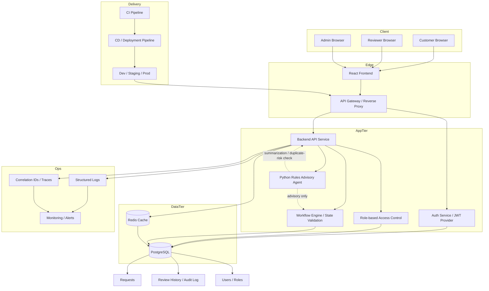
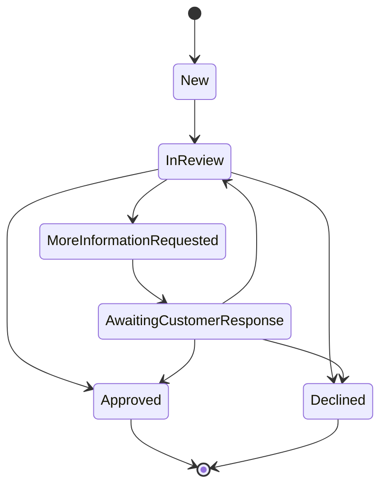

# Reimbursement Review Website - Technical Design

## 1. Objective

This document describes a workable technical solution for the reimbursement review workflow . The goal is to replace the current spreadsheet-and-email process with a web application that lets customers submit reimbursement requests and lets reviewers assess, approve, decline, or request more information.

A fictional seed data set is maintained separately in [seed-data.md](seed-data.md) for local demo and testing.

The solution is designed to satisfy the following business requirements:

- customers can submit reimbursement requests with the required fields
- customers can track the progress and outcome of their request
- reviewers can find requests requiring attention and move them through a review lifecycle
- the system prevents duplicate submissions and competing reviewer decisions
- data persists across application restarts
- the design supports the expected scale of roughly 10,000 requests per month with up to 20 reviewers

---

## 2. Business context and constraints

### Current process

The current workflow is manual and fragile:

- customers send expense details by email
- an operations person records each request in a shared spreadsheet
- reviewers check the spreadsheet, decide on each request, and update status manually
- customers are informed of the outcome through ad hoc communication

### Problems to eliminate

- customers cannot see the status of their request
- duplicate submissions are likely
- multiple reviewers may act on the same request at once, creating conflicting decisions
- spreadsheets do not provide reliable workflow enforcement or audit history

### Explicit constraints from the requirement

- solution must include frontend, backend, and persistent storage
- request and review info must remain available after restart
- no real email or spreadsheet integration is required
- no hidden reimbursement rules are required; reviewers make decisions manually
- production authentication is out of scope
- the solution should be practical and coherent rather than over-built

---

## 3. Functional requirements mapping

| Requirement | Design response |
| --- | --- |
| Customer can submit reimbursement request | Web form backed by REST API and database | 
| Request includes customer reference, date, amount in INR, and description | Validation schema and DB columns | 
| Customer receives request reference | generated unique request ID/reference | 
| Customer can track request status | request lookup screen and status timeline | 
| Reviewer can find requests needing attention | review queue with filters by status | 
| Reviewer can approve, decline, or ask for more info | explicit state transitions and decision form | 
| Customer can respond after more information requested | response workflow and status updates | 
| No duplicate submissions | dedupe hash and unique constraint | 
| No competing reviewer actions | optimistic locking and workflow validation | 
| Data survives restart | relational DB persistence |

---

## 4. Requirement coverage validation

A cross-check against the explicit requirement document shows the design covers the required business and technical concerns without missing a core workflow item:

- request submission and tracking are covered by customer forms and request lookup endpoints
- reviewer workflow is covered by queue, detail pages, and decision actions
- request status progression and explanations are covered by state transitions and audit history
- duplicate submission prevention is covered by dedupe hashing and unique constraints
- reviewer conflict prevention is covered by optimistic locking and version checks
- persistence after restart is covered by a relational database
- scale and growth are addressed through indexing, stateless APIs, and horizontal scaling guidance
- demo data and simplified identity are explicitly supported as assumptions

The only major items intentionally omitted are production-grade security, external integrations, and full operational production infrastructure, which the requirement explicitly says are outside scope.

---

## 5. Recommended architecture

### 5.1 Selected implementation stack

For an implementation-ready build, the recommended stack is:

- Frontend: React + TypeScript
- Backend: Node JS
- Database: PostgreSQL
- Cache: Redis
- Authentication: JWT-based auth with ASP.NET Identity or equivalent role-based auth layer
- Logging and observability: structured JSON logs, request correlation IDs, centralized log sink
- Deployment: Docker + CI/CD pipeline with staging and production promotion
- Optional advisory layer: a Python rules agent for duplicate-risk analysis and request summarization; advisory only and never the final decision-maker

This stack is suitable for the project scope and provides strong transaction support, role-based access control, and straightforward deployment.

### 5.2 Detailed architecture diagram



### 5.3 Authentication and authorization model

Add an explicit identity layer even though production auth is out of scope.

- user types: Customer, Reviewer, Admin
- auth mechanism: JWT access tokens issued by backend after login
- session strategy: short-lived JWT with refresh token or secure cookie pattern, depending on chosen frontend model
- role enforcement: middleware checks roles before request and review actions
- protected endpoints:
  - customer endpoints only accessible to customer role
  - reviewer endpoints only accessible to reviewer/admin role
  - admin endpoints reserved for internal operations or seed/demo data setup

Example authorization rules:

- Customers may submit requests, view their own requests, and respond to more-info requests
- Reviewers may view all requests in queue, review requests, and add explanations
- Admin may manage users, seed demo data, and inspect operational logs

### 5.4 Responsibilities by layer

#### Frontend

- collect form data for new requests
- display request lookup and submission confirmation
- show request status and decision explanation
- show reviewer queue and review actions
- display validation and conflict errors from backend
- show request timeline and activity history

#### Backend API

- validate request payloads
- enforce business rules and status transitions
- coordinate deduplication and concurrency safety
- persist decision records and status history
- provide APIs for customer and reviewer journeys
- add correlation IDs and structured logs for traceability

#### Workflow and domain layer

- hold the explicit reimbursement status machine
- validate admissible transitions
- centralize duplicate and conflict guard logic
- trigger audit logs for all status changes

#### Cache layer

- cache frequently read responses such as request lookups, reviewer queue results, and status summaries
- reduce unnecessary database load during bursts of customer submissions
- ensure cache invalidation on request updates or decision changes

#### Identity and authentication layer

- authenticate users with a simple login flow
- issue and validate JWT tokens
- map users to roles and permissions
- enforce access control on request and review endpoints
- support simplified demo accounts for customer and reviewer workflows

#### Database

- store request state and review events
- enforce integrity with constraints and indexes
- provide transactional protection for state changes
- maintain historical records for auditing and debugging
- store user credentials, role mapping, and refresh tokens if enabled

#### Observability and logging

- capture request ID, reviewer ID, customer reference, status changes, and error payloads
- log API events, database exceptions, and validation failures
- support traceability when investigating duplicate or concurrency issues

#### Optional AI agent layer

- summarize request details and history for reviewers
- identify likely duplicate submissions or unusually similar requests
- flag requests requiring human attention or missing details
- never auto-approve or auto-decline without human review authority

---

## 6. Domain model

### 6.1 Entities

#### CustomerRequest

Represents a reimbursement request submitted by a customer.

Fields:

- id: UUID or big integer primary key
- request_reference: unique human-friendly code such as REQ-000123
- customer_reference: free-form customer identifier
- expense_date: date
- amount_inr: decimal(12,2)
- description: text
- status: enum
- created_at: timestamp
- updated_at: timestamp
- dedupe_hash: text or varchar
- submitted_by: user id or simple customer identity placeholder

#### ReviewDecision

Represents the outcome of a reviewer’s action.

Fields:

- id: UUID or big integer
- request_id: foreign key to request
- reviewer_id: simple reviewer identity placeholder
- decision_type: Approve | Decline | RequestMoreInfo
- explanation: text
- created_at: timestamp

#### RequestEvent or AuditLog

Tracks the timeline of a request.

Fields:

- id: UUID or big integer
- request_id: foreign key
- event_type: Submitted | StartedReview | Approved | Declined | MoreInfoRequested | CustomerResponded | StatusUpdated
- actor_type: Customer | Reviewer | System
- actor_id: identifier
- metadata: JSONB or text
- created_at: timestamp

This historical log is useful for debugging and explaining status changes to customers and reviewers.

---

## 7. Workflow and state model

The request lifecycle should be modeled explicitly with a finite state machine.

### 7.1 Request states

- New
- InReview
- MoreInformationRequested
- AwaitingCustomerResponse
- Approved
- Declined

### 7.2 Transition rules



### 7.3 Transition rules in business terms

1. A new request starts in `New`.
2. A reviewer begins review and moves it to `InReview`.
3. A reviewer may:
   - approve → `Approved`
   - decline → `Declined`
   - request more info → `MoreInformationRequested`
4. If more information is requested, the customer sees the request and can provide a response.
5. After customer response, the request moves back to `InReview` and can be assessed again.
6. Approved and declined requests are terminal.

---

## 8. Preventing duplicate submissions

This requirement is important because the business problem explicitly mentions customers submitting the same request more than once.

### 8.1 Recommended approach

Create a normalized deduplication signature from the submission fields:

- customer reference
- expense date
- amount in INR
- description

Before insert:

- normalize strings: trim whitespace, lowercase the description, collapse repeated spaces
- compute a hash from the combined values
- check whether a request with the same dedupe hash already exists for the same customer

If a match exists:

- return the existing request reference
- do not create another record
- show a clear message such as “This request is already in progress”

### 8.2 Database enforcement

Add a unique index to the dedupe hash field for the relevant customer scope, such as:

- unique(customer_reference, dedupe_hash)

This prevents a second insertion even if the application logic misses it.

### 8.3 Why this approach works

It prevents accidental duplicates while still allowing legitimate separate requests with different dates, amounts, or descriptions.

---

## 9. Preventing competing reviewer actions

The requirement says reviewers may work on the same request at the same time and overwrite each other.

### 9.1 Recommended approach: optimistic locking

For each request, add a version column.

Example:

- version: integer

When a reviewer opens a request, they read the current version.

When they save a decision:

- update the request only if `version = current_version`
- increment version on successful update

If the version has changed, the transaction fails and the reviewer is told that someone else has already updated the request.

### 9.2 Why optimistic locking is a good fit

- the workload is moderate
- conflicts are infrequent but important
- it avoids heavy locking and is easier to implement in a web app

### 9.3 Alternative: claim/lock pattern

A company may also choose a simpler pattern:

- reviewer claims the request before working on it
- only the assigned reviewer can finalize it
- other reviewers can still view but cannot complete the decision

This is useful if the workflow expects a reviewer to take ownership before action. It is compatible with the same database model.

---

## 10. Logging and observability design

Operational visibility is essential for a workflow application that handles uncertain or overlapping reviewer activity. The system should log key events at multiple layers without exposing sensitive business data beyond the required workflow information.

### 10.1 Structured logging

Use structured logs for all request lifecycle changes, for example:

- requestId
- customerReference
- reviewerId
- requestStatus
- eventType
- outcome
- timestamp
- correlationId
- errorCode
- errorMessage

Example log fields:

- submission created
- duplicate detected
- reviewer decision submitted
- version conflict detected
- customer response submitted
- request status changed to Approved or Declined

### 10.2 Correlation and traceability

Every API request should carry a correlation ID. The correlation ID is logged across:

- frontend request metadata
- backend request logs
- database transaction logs or audit events
- error traces in monitoring systems

This helps diagnose issues like duplicate submissions or conflicting reviewer actions quickly.

### 10.3 Audit logging requirements

A request’s lifecycle should be fully auditable. The system logs every state transition and actor action, not just the final result. This is useful for:

- support investigations
- reviewer reconciliation
- compliance or internal review needs
- debugging workflow bugs

### 10.4 Monitoring and alerting

Monitoring should cover:

- request submission failure rate
- review queue backlog growth
- duplicate detection spikes
- database lock/conflict rate
- API latency or error rate
- cache hit ratio

---

## 11. Cache mechanism design

Caching should be light, targeted, and safe. The goal is not to cache everything, but to reduce read pressure for repetitive workflows.

### 11.1 Recommended cache strategy

Use Redis for read-heavy, low-risk items such as:

- customer request lookup by reference
- reviewer queue summary counts
- recent request status list
- status summary cards or dashboard metrics
- small metadata lookups

### 11.2 Cache key patterns

Examples:

- request:reference:{requestReference}
- reviewer:queue:{status}:{page}:{pageSize}
- customer:requests:{customerReference}
- status:summary:{date}

### 11.3 Cache invalidation rules

Cache entries must be invalidated or refreshed when:

- a new request is created
- a status changes
- a reviewer decision is saved
- a customer response is recorded
- any request event is appended to history

### 11.4 Why this is safe

The system uses Redis only for repeatable read operations and not as the source of truth. The database remains the system of record. Caching improves performance without compromising correctness.

### 11.5 Cache failure handling

If Redis is unavailable:

- the app should continue to operate using the database directly
- degraded mode should be logged as a warning
- user experience should remain functional without introducing stale data risks

---

## 12. Deployment pipeline strategy

The deployment strategy should be simple but repeatable, with environment separation and quality gates.

### 12.1 CI pipeline

The CI pipeline should run on every push or pull request and include:

- dependency install
- linting
- unit tests
- integration tests
- schema migration validation
- build of frontend and backend
- static analysis and vulnerability check

### 12.2 Deployment flow

Recommended flow:

1. developer pushes code
2. CI pipeline runs tests and build checks
3. successful build creates deployable artifacts
4. deployment to a staging environment for user validation
5. database migration runs in staging
6. smoke tests verify key flows
7. manual approval or release gate triggers production deployment
8. production deployment runs migrations and verifies core endpoints

### 12.3 Environment separation

Use three environments:

- Development: local feature validation
- Staging: release validation and demo flows
- Production: live workflow environment

### 12.4 Database migration safety

Database changes should be versioned and applied via migration scripts. This ensures:

- predictable schema evolution
- safe rollback plans for breaking changes
- consistent behavior across environments

### 12.5 Deployment resilience

For production, use:

- health checks
- rolling deployment strategy
- containerization if using Kubernetes or Docker Compose
- basic rollback mechanism if smoke tests fail

---

## 13. Agentification and AI-assisted workflow

The POC includes a deterministic Python agent that coordinates read-only checks and augments the reviewer workflow without replacing human accountability. It uses Python's standard library and does not call an LLM or train a predictive model.

### 13.1 Agent responsibilities

The advisory agent supports:

- checking required request details and flagging brief descriptions
- summarizing the request status and recorded history
- comparing recent requests for the same customer against explicit amount, date, and description-similarity rules
- presenting verification questions to the reviewer

### 13.2 Human-in-the-loop design

The agent never directly approves, declines, or requests more information. It does not assign a score or claim policy rules. Humans remain responsible for verifying the facts and making the final decision.

This reduces risk and aligns with the business requirement that reviewers make the actual decision manually.

### 13.3 Example agent-assisted workflow

1. customer submits a reimbursement request
2. reviewer requests an advisory from the reviewer screen
3. the reviewer module reads request facts, review history, and recent same-customer requests
4. the Python agent applies deterministic completeness and similarity checks and returns observations and questions
5. the reviewer verifies the source records and makes a decision through the existing workflow
6. only the reviewer decision is persisted in the audit log

### 13.4 Why this improves the product

It helps with the operational volume and reduces reviewer effort without introducing unsafe automation.

---

## 14. Data persistence and storage design

A relational database is a strong fit because the project requires:

- strong consistency for review status transitions
- easy querying by request reference and status
- auditability and historical record keeping

### 14.1 Suggested schema

#### requests table

| Column | Type | Notes |
| --- | --- | --- |
| id | UUID / bigint | primary key |
| request_reference | varchar(50) | unique |
| customer_reference | varchar(100) | indexed |
| expense_date | date | required |
| amount_inr | decimal(12,2) | required |
| description | text | required |
| status | varchar(30) | enum-like string |
| dedupe_hash | varchar(255) | indexed unique with customer_reference |
| version | int | optimistic lock counter |
| created_at | timestamp | |
| updated_at | timestamp | |
| submitted_by | varchar(100) | simplified identity |

#### review_decisions table

| Column | Type | Notes |
| --- | --- | --- |
| id | UUID / bigint | primary key |
| request_id | FK | references requests |
| reviewer_id | varchar(100) | simple identity |
| decision_type | varchar(30) | approve, decline, request_more_info |
| explanation | text | customer-visible reason |
| created_at | timestamp | |

#### request_events table

| Column | Type | Notes |
| --- | --- | --- |
| id | UUID / bigint | primary key |
| request_id | FK | references requests |
| event_type | varchar(50) | workflow event |
| actor_type | varchar(20) | customer, reviewer, system |
| actor_id | varchar(100) | |
| metadata | JSONB | optional structured payload |
| created_at | timestamp | |

### 14.2 Index requirements

Key indexes:

- request_reference unique index
- customer_reference + dedupe_hash unique index
- status + created_at for queue queries
- updated_at for recent activity queries
- request_id for review_decisions and request_events

---

## 15. API design

A REST-style API is enough for this project.

### 15.1 Submit request

#### POST /api/requests

Request body:

```json
{
  "customerReference": "CUST-1001",
  "expenseDate": "2026-10-01",
  "amountInr": 2500.00,
  "description": "Travel expenses for client meeting"
}
```

Response:

```json
{
  "requestReference": "REQ-000123",
  "status": "New",
  "message": "Request submitted successfully"
}
```

If the request is a duplicate:

```json
{
  "requestReference": "REQ-000123",
  "status": "InReview",
  "message": "This request already exists and is being processed"
}
```

### 15.2 Get request by reference

#### GET /api/requests/:reference

Response:

```json
{
  "requestReference": "REQ-000123",
  "customerReference": "CUST-1001",
  "expenseDate": "2026-10-01",
  "amountInr": 2500.00,
  "description": "Travel expenses for client meeting",
  "status": "MoreInformationRequested",
  "history": [
    {
      "eventType": "Submitted",
      "timestamp": "2026-10-07T10:10:00Z"
    },
    {
      "eventType": "MoreInformationRequested",
      "timestamp": "2026-10-07T11:00:00Z",
      "explanation": "Please provide invoice copy"
    }
  ]
}
```

### 15.3 List review queue

#### GET /api/reviewer/requests?status=New&status=AwaitingCustomerResponse

Response:

```json
[
  {
    "requestReference": "REQ-000123",
    "customerReference": "CUST-1001",
    "amountInr": 2500.00,
    "status": "New",
    "createdAt": "2026-10-07T10:10:00Z"
  }
]
```

### 15.4 Reviewer decision

#### POST /api/requests/:id/review

Request body:

```json
{
  "reviewerId": "REV-07",
  "decision": "approve",
  "explanation": "Expense matches policy and supporting details are complete",
  "version": 3
}
```

Response:

```json
{
  "status": "Approved",
  "message": "Request approved successfully"
}
```

If there is a version conflict:

```json
{
  "error": "Request was updated by another reviewer. Please refresh and retry.",
  "statusCode": 409
}
```

### 15.5 Customer response to more information request

#### POST /api/requests/:id/respond

Request body:

```json
{
  "customerReference": "CUST-1001",
  "response": "Attached invoice and receipt as requested.",
  "version": 5
}
```

Response:

```json
{
  "status": "InReview",
  "message": "Response submitted and review has resumed"
}
```

---

## 16. Frontend design

### 16.1 Customer experience

Pages:

- Submit request
- Track request by reference
- View status and outcome
- Respond to more information request

### 16.2 Reviewer experience

Pages:

- Queue of open requests
- Request detail screen
- Decision panel with approve, decline, request more info actions
- Explanation text area visible to customer

### 16.3 UI principles

- simple, direct, and workflow-centered
- clear status labels
- visible timeline for each request
- no unnecessary visual complexity

The website is meant to solve operations pain, not to be a polished marketing site.

---

## 17. Security and identity assumptions

The requirement explicitly says production authentication is out of scope, but for implementation readiness we should still include a minimal but disciplined auth model.

Recommended implementation approach:

- use a simple login flow for customer and reviewer users
- password hashing with a secure algorithm such as bcrypt or ASP.NET Identity password hashing
- JWT access tokens for authenticated API calls
- refresh tokens or secure session cookies for continued access
- role-based authorization enforced in backend middleware
- demo users seeded for quick local testing

This is not production-grade identity infrastructure, but it gives the application a realistic separation of customer and reviewer access while staying within the exercise scope.

Minimal user table:

- id
- email
- passwordHash
- fullName
- role
- isActive
- createdAt

Seeded demo users should be loaded from [seed-data.md](seed-data.md), including one customer, reviewer, and admin example set. This keeps the development environment realistic and easy to demo.

Recommended roles:

- Customer
- Reviewer
- Admin

---

## 18. Data flow examples

### Customer submits request

1. customer enters request details in the UI
2. frontend sends data to API
3. API validates required fields
4. API computes dedupe hash
5. database checks for duplicate active request
6. if unique, insert new request with status = New
7. API returns generated request reference
8. frontend shows confirmation page

### Reviewer approves request

1. reviewer loads request from queue
2. API returns request and version
3. reviewer chooses approve and enters explanation
4. API validates current status and version
5. database updates status to Approved and appends decision history
6. API returns success response
7. customer later sees final decision in their request view

### Customer responds to more information request

1. system has request status = MoreInformationRequested
2. customer submits follow-up response
3. API validates request state and version
4. status changes to InReview or AwaitingCustomerResponse depending on workflow
5. reviewer queue updates with the request again

---

## 19. Scale and future growth

The requirement says to explain how the design could support the stated scale and future growth.

### 19.1 Current scale assumptions

- approximately 10,000 requests per month
- up to 20 reviewers
- occasional bursts of customer submissions

### 19.2 Why this design scales acceptably

- database indexes support queue and lookup queries efficiently
- app tier is stateless and can be scaled horizontally
- business logic is centralized in a single API layer
- the schema avoids complex joins by keeping the data model simple

### 19.3 Growth path

As volume grows, the system can evolve in a straightforward way:

- add authentication and role-based access control
- add email or messaging notifications for status changes
- add reporting dashboards for operational teams
- add caching for common lookup queries
- add background workers for asynchronous tasks if needed
- add multi-tenant support or separate company contexts

This is a good foundation for a production-ready workflow application without needing to over-engineer it for the exercise.

---

## 20. Implementation plan

### Phase 1: Foundation

- create project skeleton
- define database schema and migrations
- implement basic request submission flow
- ensure request persistence and lookup work

### Phase 2: Review workflow

- build reviewer queue
- implement approve/decline/request-more-info actions
- add status transitions and explanation storage
- add request history timeline

### Phase 3: Concurrency and deduplication

- add dedupe hash and uniqueness checks
- add versioning and optimistic locking
- verify conflict handling

### Phase 4: UX polish and demo data

- add seeded demo data for customers and reviewers
- add sample requests and review decisions
- ensure journeys are easy to demonstrate

### Phase 5: Hardening

- validation and error handling
- clear UI states for duplicates and conflicts
- final documentation and run instructions

---

## 21. Assumptions, key decisions, tradeoffs, and unfinished work

### Assumptions

- customer and reviewer identity are simplified and not production-authenticated
- there are no external reimbursement rules or payment integrations
- this is a single-tenant exercise application
- there is no need for real email or spreadsheet integration

### Key decisions

- relational database instead of spreadsheet or document store
- explicit workflow state machine rather than ad hoc status strings
- optimistic locking for concurrent reviewer actions
- dedupe hash to eliminate repeated submissions
- REST API for simplicity and clarity

### Tradeoffs

- a single database is simpler than a distributed event-driven system
- optimistic locking is lighter than full pessimistic locking
- a simplified identity model is enough for the assignment but not production ready

### Unfinished work

- no production security model
- no real external notification system
- no automated load testing
- no integration with real email or payment systems

These are acceptable within the assignment scope and should be documented clearly.

---

## 22. Recommended final solution summary

The best implementation for this requirement is a web application with:

- a customer submission and tracking interface
- a reviewer queue and decision workflow
- a relational database for persistence and audit history
- dedupe logic to block duplicate submissions
- optimistic locking to prevent conflicting reviewer actions
- a state machine to ensure valid transitions and clear status reporting

This design solves the business pain described in the requirement while staying manageable for a take-home assignment.

---

## 23. AI usage note

This technical design was generated based on the written requirements based on the requirement document and was checked against the explicit business constraints mentioned by the user after multiple iterations. The design emphasizes the requirement-driven workflow and avoids assumptions outside the scope of the exercise. 

---

## 24. Deliverables checklist

The solution should include:

- working frontend
- working backend
- persistent database
- demo data seed scripts
- setup and run instructions
- request tracking and review flow
- duplicate-submission handling
- reviewer conflict handling
- minimal login/authentication flow
- seeded demo users and sample requests loaded from [seed-data.md](seed-data.md)
- brief technical explanation and assumptions

This design provides the structure needed to implement those deliverables cleanly.

---

## 25. Database schema (implementation-ready SQL)

The following schema is a practical baseline for the MVP.

```sql
CREATE TABLE users (
    id UUID PRIMARY KEY,
    email VARCHAR(255) NOT NULL UNIQUE,
    password_hash VARCHAR(255) NOT NULL,
    full_name VARCHAR(255) NOT NULL,
    role VARCHAR(30) NOT NULL CHECK (role IN ('Customer', 'Reviewer', 'Admin')),
    is_active BOOLEAN NOT NULL DEFAULT TRUE,
    created_at TIMESTAMP NOT NULL DEFAULT NOW()
);

CREATE TABLE requests (
    id UUID PRIMARY KEY,
    request_reference VARCHAR(50) NOT NULL UNIQUE,
    customer_id UUID NOT NULL REFERENCES users(id),
    customer_reference VARCHAR(100) NOT NULL,
    expense_date DATE NOT NULL,
    amount_inr DECIMAL(12,2) NOT NULL,
    description TEXT NOT NULL,
    status VARCHAR(30) NOT NULL CHECK (status IN (
        'New', 'InReview', 'MoreInformationRequested', 'AwaitingCustomerResponse', 'Approved', 'Declined'
    )),
    dedupe_hash VARCHAR(255) NOT NULL,
    version INT NOT NULL DEFAULT 0,
    created_at TIMESTAMP NOT NULL DEFAULT NOW(),
    updated_at TIMESTAMP NOT NULL DEFAULT NOW()
);

CREATE TABLE review_decisions (
    id UUID PRIMARY KEY,
    request_id UUID NOT NULL REFERENCES requests(id) ON DELETE CASCADE,
    reviewer_id UUID NOT NULL REFERENCES users(id),
    decision_type VARCHAR(30) NOT NULL CHECK (decision_type IN ('Approve', 'Decline', 'RequestMoreInfo')),
    explanation TEXT,
    created_at TIMESTAMP NOT NULL DEFAULT NOW()
);

CREATE TABLE request_events (
    id UUID PRIMARY KEY,
    request_id UUID NOT NULL REFERENCES requests(id) ON DELETE CASCADE,
    event_type VARCHAR(50) NOT NULL,
    actor_type VARCHAR(20) NOT NULL CHECK (actor_type IN ('Customer', 'Reviewer', 'System')),
    actor_id UUID,
    metadata JSONB,
    created_at TIMESTAMP NOT NULL DEFAULT NOW()
);

CREATE TABLE refresh_tokens (
    id UUID PRIMARY KEY,
    user_id UUID NOT NULL REFERENCES users(id),
    token_hash VARCHAR(255) NOT NULL,
    expires_at TIMESTAMP NOT NULL,
    revoked BOOLEAN NOT NULL DEFAULT FALSE,
    created_at TIMESTAMP NOT NULL DEFAULT NOW()
);

CREATE INDEX idx_requests_customer_ref ON requests(customer_reference);
CREATE INDEX idx_requests_status_created ON requests(status, created_at);
CREATE INDEX idx_requests_dedupe ON requests(customer_reference, dedupe_hash);
CREATE INDEX idx_review_decisions_request ON review_decisions(request_id);
CREATE INDEX idx_events_request ON request_events(request_id, created_at);
```

### Recommended unique rule for duplicates

```sql
CREATE UNIQUE INDEX ux_requests_customer_dedupe
ON requests(customer_reference, dedupe_hash);
```

---

## 26. Backend API endpoint specification

The backend should expose a compact but complete set of routes.

### Authentication routes

- POST /api/auth/login
  - body: { email, password }
  - response: { token, refreshToken, user }
- POST /api/auth/logout
- POST /api/auth/refresh

### Customer routes

- POST /api/requests
  - creates a reimbursement request
  - requires Customer role
- GET /api/requests/my
  - fetches all requests for the logged-in customer
- GET /api/requests/:reference
  - fetch request details by reference
- POST /api/requests/:id/respond
  - customer replies when more information was requested

### Reviewer routes

- GET /api/reviewer/requests
  - returns queue of requests requiring attention
- GET /api/reviewer/requests?status=New
  - optionally filters the queue by one or more active workflow statuses
- GET /api/reviewer/requests/:id
  - fetches detailed request and history
- POST /api/reviewer/requests/:id/start
  - moves a New request to InReview using an optimistic version check
- POST /api/reviewer/requests/:id/advisory
  - returns a non-binding Python rules advisory for reviewers; does not change request state
- POST /api/reviewer/requests/:id/review
  - approve, decline, or request more info

### Admin routes

- GET /api/admin/users
- POST /api/admin/seed-demo-data
- GET /api/admin/health

### Example request/response payloads

#### Submit request

```json
{
  "customerReference": "CUST-1001",
  "expenseDate": "2026-10-01",
  "amountInr": 2500.00,
  "description": "Travel expenses for client presentation"
}
```

#### Reviewer decision

```json
{
  "decision": "approve",
  "explanation": "Receipts and business purpose are clear.",
  "version": 3
}
```

#### Customer response

```json
{
  "response": "Attached the invoice and proof of attendance.",
  "version": 5
}
```

---

## 27. React frontend page map

### Customer pages

- Login / Sign in
- Submit Request page
- My Requests page
- Request Detail page
- More Information Response page

### Reviewer pages

- Reviewer Login
- Review Queue page
- Review Detail page
- Decision Panel / Approve or Decline page

### Admin pages

- Admin Dashboard
- User Management
- Seed Data Controls
- System Logs / Health Monitor

### Shared components

- Header with navigation and user role info
- Request Timeline component
- Status Badge component
- Decision Summary component
- Error Banner component
- Toast / Success Notification component

### Recommended page flow

1. Customer logs in
2. Customer submits request
3. App displays request reference and status
4. Customer views request and history
5. Reviewer logs in and reviews request queue
6. Reviewer approves, declines, or requests more info
7. Customer receives updated status and may respond
8. Admin can seed demo data and inspect health or logs

---

## 28. Local implementation checklist

Use this simple sequence to build the MVP:

1. Create PostgreSQL database and run migrations
2. Create users table and seed demo users from [seed-data.md](seed-data.md)
3. Create request, review_decision, request_event, and refresh_token tables
4. Implement authentication and JWT middleware
5. Implement request submission API with duplicate detection
6. Implement request query APIs for customer and reviewer
7. Implement reviewer decision endpoint with version check
8. Build React login and request form pages
9. Build reviewer queue and review detail pages
10. Add structured logs and correlation IDs
11. Add Redis cache for queue and request summary reads
12. Add CI pipeline and deployment config
13. Validate end-to-end customer and reviewer journeys

---

## 29. Implementation guidance summary

The project should be built in small vertical slices, with the main path being:

- auth and user roles
- request creation and dedupe logic
- review queue and decision workflow
- audit and status history
- logging, caching, and deployment

This ordering reduces risk and keeps the solution aligned with the business workflow described in the requirement document.

## 30. Current POC delivery status

The local POC implements and tests customer submission, duplicate detection, reference lookup and event history, reviewer status filtering, review start/decision transitions, customer responses, role checks, refresh-token rotation/revocation, and admin read-only user listing. SQLite data persistence is verified across backend process restarts.

### Backend source organization

- `backend/src/modules/` contains feature-owned routes and logic. Authentication, requests, reviewer workflow, and admin functionality each have their own module; demo seed logic and data belong to the admin module.
- `backend/src/agents/reimbursementAdvisory/` contains the Python rules agent and its Node subprocess adapter.
- `backend/src/shared/` contains cross-cutting infrastructure such as configuration, database setup, middleware, and the shared workflow read cache.
- `backend/src/utils/` contains reusable request and workflow helpers without feature ownership.

Local operational substitutes are intentionally lightweight:

- SQLite is used instead of the production-target PostgreSQL database.
- A five-second in-process cache is used for customer lists, request details, and reviewer queues; lifecycle writes invalidate it. Replace this with Redis before horizontally scaling.
- JSON request and workflow logs include generated correlation IDs, but no centralized log sink, tracing backend, or alerting is configured.
- CI runs backend tests, the frontend build, and Playwright browser tests. Deployment promotion to staging/production remains environment-specific and is not configured here.

The Python advisory agent is implemented as deterministic rules, not a trained model or LLM; its duplicate checks are limited to the most recent same-customer requests and require reviewer verification. Production identity hardening, secure-cookie refresh storage, external notifications, load testing, PostgreSQL migration, full admin user management, and operational monitoring UI remain outside this local POC.
